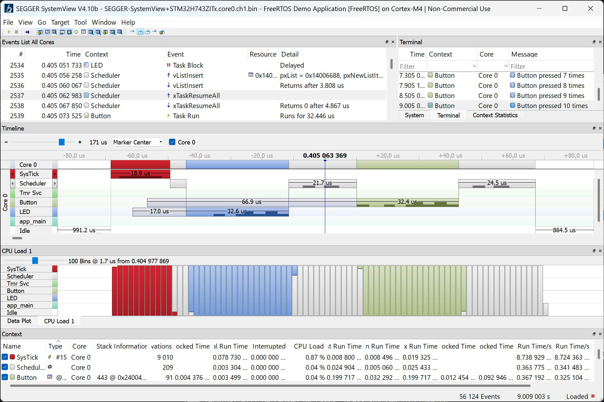

# SEGGER-SystemView
This example project shows how to use SEGGER SystemView with pyOCD.

It streams FreeRTOS and system activity to the SEGGER SystemView application for graphical inspection:



pyOCD reads RTT data directly from target memory.

This example uses the NUCLEO-H743ZI2 board. The same approach also works with other devices and boards.

## Quick Start
1. Install
   [Keil Studio for VS Code](https://marketplace.visualstudio.com/items?itemName=Arm.keil-studio-pack)
   from the VS Code marketplace.
2. Clone this repository, for example, using
   [Git in VS Code](https://code.visualstudio.com/docs/sourcecontrol/intro-to-git),
   or download the ZIP file. Then open the repository root folder.
3. Let the related tools and software packs download and install. Review progress with **View > Output > CMSIS Solution**.
4. Connect the board to the PC.
5. Build and load the project with the CMSIS View
   [action buttons](https://github.com/Open-CMSIS-Pack/vscode-cmsis-solution#action-buttons).
6. Press the User button on the board 10 times. This ends the pyOCD session and the streaming.
7. In the SystemView application, open the file `.\out\SEGGER-SystemView+STM32H743ZITx.core0.ch1.bin`.
8. Inspect the system and RTOS activity.

## Requirements
To use SEGGER SystemView as shown in this example in your own project, install the following additional packs:
- `Segger::RTT` pack, version 8.58.0 or later
- `Segger::SystemView` pack version 4.12.0 or later
- `ARM::CMSIS-Compiler` pack, version 2.3.0 or later
- `ARM::CMSIS-FreeRTOS` pack version 11.0.1 or later

To view the data captured from the running application, the Segger [SystemView application](https://www.segger.com/products/development-tools/systemview/) is required.

## Adding SystemView Streaming to an Application
1. In the [Software Components view](https://github.com/Open-CMSIS-Pack/vscode-cmsis-solution#software-components-view), enable the following:
  - `Segger -> RTT`
  - `Segger -> SystemView`, `FreeRTOS` variant
2. Add the following code to your application:
  - At the end of `FreeRTOSConfig.h` add:
    ```
    #include "SEGGER_SYSVIEW_FreeRTOS.h"
    ```
  - Include the required header files:
    ```
    #include "FreeRTOSConfig.h"
    ```
  - Start streaming before the RTOS initialization:
    ```
    traceSTART();
    ```
  - Send messages to the SystemView application:
    ```
    SEGGER_SYSVIEW_PrintfHost("Button pressed %d times", count);
    ```
3. Solution and Project Configuration
  - In the `csolution.yml` file, add the following [`rtt:`](https://open-cmsis-pack.github.io/cmsis-toolbox/pyOCD-Debugger/#rtt) node under the [`debugger:`](https://open-cmsis-pack.github.io/cmsis-toolbox/pyOCD-Debugger/#debugger) node:
    ```
           rtt:
             - channel:
                 - number: 1
                   mode: systemview
    ```

#### Optional configurations
1. Instead of streaming to a file, it is also possible to stream directly to the SystemView application via a network connection.  To test this mode, change **Target Set** from **systemview-file** to **systemview-server** in the  [Manage Solution view](https://github.com/Open-CMSIS-Pack/vscode-cmsis-solution#manage-solution-view) dialog.
